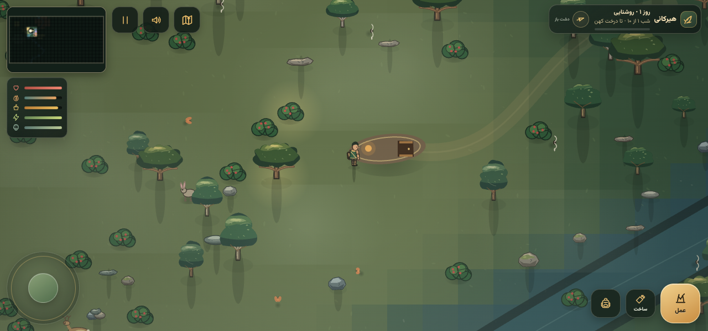
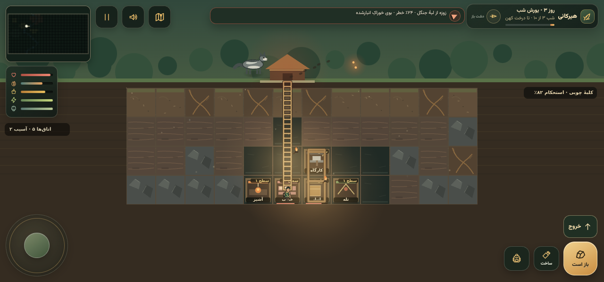

<p align="center"></p>

# Hirkani

[فارسی](README.fa.md) · English

**Find shelter before the forest goes dark.** Hirkani is a mobile-first, 2D survival game inspired by the Hyrcanian forests of northern Iran. Gather what you need, build a refuge beneath the soil, and uncover a family story one night at a time. The in-game interface is in Persian.




*Screenshots were generated from the game using its prepared QA scenarios.*

## The journey

- Explore a procedural forest, gather food and materials, and watch your health, hunger, warmth and stamina.
- Dig a bunker, connect its passages and ladders, build and repair rooms, and prepare for nightly raids.
- Find diary pages and ruins, unlock shelter blueprints, and follow the clues toward the Ancient Tree.
- Play offline in landscape with touch controls, autosave, a map, adjustable sound and a skippable introduction.

Each day offers time to explore and prepare; each night tests the shelter. At dawn, recover, repair and decide where to go next.

## Controls

On a touch screen, drag the left joystick to move; push it farther to run. Use the gold action button to interact or gather. Open the backpack or crafting panel with the buttons on the right. In the bunker, tap a cell and use the relevant dig, build or repair action; the exit button leads back outside, with a warning if danger is near. The map, status panel and pause controls are at the top of the screen.

On a keyboard, use **WASD** or **arrow keys** to move, **E** or **Space** to interact, and **Escape** or **Backspace** to close panels or pause.

## Technology

The game runs in a browser using vanilla JavaScript and Canvas, with procedurally drawn scenery and synthesized Web Audio alongside bundled, openly licensed sound loops and a local font. Capacitor 6 wraps the same `www/` files for Android. The game does not require a network connection to play; saves are stored locally on the device.

To try the web version, serve the web directory and open the displayed address in a modern browser:

```sh
python3 -m http.server 8000 --directory www
```

## Android APK

The [Actions page](https://github.com/canoheil/hirkani/actions) provides a **hirkani-debug-apk** artifact for successful debug builds. Download and unzip it, transfer the APK to an Android device, and allow installation from the chosen source when Android prompts you. Debug builds are intended for testing and are not production-signed. Saved data may be removed if the app is uninstalled; a build signed with a different key may not update an existing installation.

To build locally, install Node.js 20, Java 17, Android SDK platform 34 and build-tools 34.0.0, then:

```sh
npm ci
npx cap add android
bash scripts/patch-android.sh
npx cap sync android
cd android
chmod +x gradlew
./gradlew assembleDebug
```

The APK is at `android/app/build/outputs/apk/debug/app-debug.apk`. The generated `android/` directory is ignored; do not edit it as source. The debug workflow regenerates it, applies the committed resources and configuration, then builds. A `v*` tag triggers the release workflow, which publishes a **debug-signed** `Hirkani-<tag>.apk` (for example, `Hirkani-v1.0.0.apk`). No release tag is created by the build instructions.

## Repository

| Path | Purpose |
| --- | --- |
| `www/index.html` | Game, UI, Canvas renderer and audio logic |
| `www/audio/`, `www/fonts/` | Bundled sound and font assets |
| `resources/` | Editable icon SVGs and visual review sheet |
| `android-res/` | Pre-rendered Android resources used by CI |
| `scripts/patch-android.sh` | Applies configuration and resources after Android generation |
| `scripts/render-icons.py` | Optional design-time asset renderer (Pillow and `@resvg/resvg-js` required; not needed in CI) |
| `docs/` | Screenshots, icon and design notes |

## Credits and license

The game code is distributed under the [MIT License](LICENSE). Audio recordings and their individual licenses, authors and original sources are documented in [CREDITS.md](CREDITS.md) and in the game's About screen; they are not relicensed under MIT. The bundled Vazirmatn font is covered by the [SIL Open Font License](www/fonts/OFL.txt).
